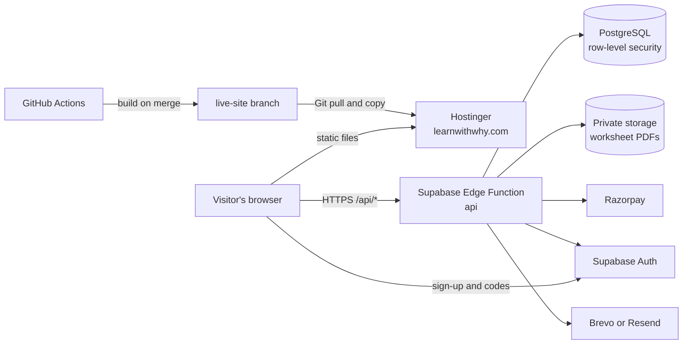

<div align="center">

# Learn With Why

**An online store for printable Kindergarten worksheets, with a protected PDF viewer, Razorpay payments and a Supabase backend.**

[](https://www.learnwithwhy.com)
[](https://github.com/SumitDendage/kids-book-website/actions/workflows/publish-website.yml)
[](LICENSE)

**[www.learnwithwhy.com](https://www.learnwithwhy.com)**


</div>

## Contents

- [Overview](#overview)
- [Key features](#key-features)
- [Technology stack](#technology-stack)
- [Architecture](#architecture)
- [Repository structure](#repository-structure)
- [Getting started](#getting-started)
- [Configuration](#configuration)
- [Usage](#usage)
- [API](#api)
- [Database](#database)
- [Testing](#testing)
- [Deployment](#deployment)
- [Security](#security)
- [Known limitations](#known-limitations)
- [Troubleshooting](#troubleshooting)
- [Roadmap](#roadmap)
- [Contributing](#contributing)
- [License](#license)
- [Contact](#contact)

## Overview

Learn With Why sells printable learning worksheets for young children. Parents, teachers and schools browse the library, try free sheets without an account, and buy the rest one sheet at a time or through a class subscription.

The project addresses three problems a small worksheet publisher has:

1. **Selling digital sheets without giving away the files.** PDFs stay in private cloud storage. The server checks access on every request and streams a copy stamped with the buyer's name and email to an in-browser viewer.
2. **Taking payments safely.** Prices are calculated on the server, and access is granted only after the payment is verified with Razorpay.
3. **Running the shop without a developer.** Staff manage sheets, prices, orders, customers, coupons, costs and account-sharing cases from an admin panel.

The catalogue covers **Kindergarten English and vocabulary: 125 sheets in 12 sections, 27 of them free**, according to the catalogue snapshot in [`frontend/scripts/seo-catalogue-snapshot.json`](frontend/scripts/seo-catalogue-snapshot.json). Staff can change the catalogue at any time. Class 1, Class 2 and Class 3 are shown as coming soon.

## Key features

### Customer website

- **Worksheet library.** Alphabet sections (letter tracing, letter recognition, picture reading, matching upper and lower case, letters before and after, beginning sounds, ending sounds, missing letters) and an illustrated Vocabulary board whose Colours, Shapes, Sizes and Animals topics have sheets. Every card shows a thumbnail.
- **Free sheets without an account.** Free sheets open through a short-lived, view-only guest token and are stamped as free copies. Paid sheets always require a signed-in customer with access.
- **Shop.** Views for All, New, Bestselling, Free and Subscription, filters by class, subject and section, text search, and a cart.
- **Class subscriptions.** A plan opens every sheet in a class while it runs. Plans and prices come from the server; the defaults are 1, 3 and 6 months in India, plus 12 months in other countries.
- **Checkout.** Server-side pricing with country detection, GST for India, local currency and tax for other countries, coupons, and a stored 15-minute quote so the browser cannot change a price.
- **Accounts.** Sign-up with a chosen password and a 6-digit email confirmation code. Sign-in is two-step: password, then a 6-digit code sent by email. Customers pick an account type once (Parent, Teacher or Organization), which sets their print allowance per sheet (defaults: 2, 3 and 300).
- **Timed access.** A bought sheet stays open for a configurable number of hours (default: 1) with a live countdown, then leaves the account and can be bought again.
- **My Account.** Current sheets, class plans, order history, signed-in devices, security status and appeals.
- **Help chat.** Answers from a curated FAQ: first in the browser from [`faq.json`](frontend/src/data/faq.json), then from the published FAQ in the database. It uses keyword and similarity search, not a language model.
- **Storybook design.** A scroll-driven landscape built from 960 frames, with animals, birds and waterfalls drawn live on canvas. Reduced-motion settings are respected.
- **Search engine pages.** The build writes static HTML pages for every topic under `/kindergarten-worksheets/` and a sitemap, so sheets can be indexed without running the single-page app.

### Protected viewer

- PDFs are rendered with pdf.js from a copy stamped on the server with the customer's name and email.
- Access is re-checked every minute; the sheet closes when access ends, even while offline.
- Printing is counted against the customer's allowance; downloads are off unless staff allow them for a sheet.
- Right-click, drag, copy and the print and save shortcuts are blocked, and the page blurs when the window loses focus.

### Account-sharing protection

- The server records sessions, devices, networks and countries, and raises incidents based on rules staff can tune.
- Two devices on networks they never shared, opening paid sheets within 15 minutes, produce a warning automatically; other incidents become warnings when staff confirm them.
- Three active warnings pause paid access. Free sheets, My Account and appeals keep working.
- Staff can block a single session, pause paid access or block an account. A sign-in from a new IP address sends an alert email to the shop's security contact.

### Staff panels

Staff sign in at `/admin` or `/developer` with their own accounts and the same two-step sign-in. Every action is checked against the staff member's permissions on the server.

| Admin panel (`/admin`) | Developer panel (`/developer`) |
|---|---|
| Dashboard with sales, access and visitor charts | System health dashboard |
| Products: classes, subjects and sections; upload one or many PDFs; prices, labels, scheduling, gallery, duplicate, archive | Errors recorded by the server |
| Homepage: the sheet lists on the home page and in the shop, the home page text, and review moderation | Email outbox with retry and skip |
| Orders, payments, refunds and access records | API monitoring and browser performance timings |
| Customers and their history | Database tables and row counts |
| Security: incidents, warnings, appeals and sharing rules | Payment, webhook, sign-in and security logs |
| Messages from the contact form | Deployed API and website versions |
| Analytics: sales, visitors, conversion, best sellers | Settings backup and CSV exports |
| Money: income, refunds, costs entered by the owner, monthly profit or loss | Audit log |
| Coupons, settings (including staff), audit log | |

Administrators cannot open the Developer panel.

## Technology stack

| Area | Technology |
|---|---|
| Website | React 19, React Router 7, Vite 8, plain CSS, HTML canvas |
| PDF viewer | pdf.js (`pdfjs-dist` 4.10) |
| Sign-in client | `@supabase/supabase-js` 2 |
| API | One Supabase Edge Function in TypeScript on Deno |
| Database | PostgreSQL on Supabase: 46 tables, row-level security enabled on every one |
| Auth | Supabase Auth, plus server-side sessions and email one-time codes |
| File storage | Supabase Storage: a private bucket for PDFs, a public one for covers |
| Payments | Razorpay; Stripe and PayPal gateways implemented but hidden until configured |
| Email | Brevo or Resend through an outbox with retries; Supabase Auth for confirmation codes |
| Contact form | Web3Forms |
| CI/CD | GitHub Actions |
| Hosting | Hostinger (static website), Supabase Mumbai region (API, database, storage) |
| Tests | Node test runner (website), Deno test (API), Playwright scripts (browser) |

## Architecture



- The website is static files. All business rules (prices, access, payments, warnings, staff permissions) run in the Edge Function.
- The website sends every request through the API. Row-level security is enabled on every table: 18 tables allow read-only access to public catalogue data or the caller's own rows, the other 28 have no policy at all, and no policy allows a write. The API connects with only the grants it needs.
- A sheet opens only when the API finds a valid entitlement (created after a verified payment, by a plan or by an audited staff grant), then returns a watermarked copy.

More detail: [docs/ARCHITECTURE.md](docs/ARCHITECTURE.md).

## Repository structure

```
kids-book-website/
├── frontend/                  React website, staff panels and viewer
│   ├── src/
│   │   ├── components/        Site sections: home, sheets, store, checkout, account, security, help chat
│   │   ├── pages/             Admin/, Developer/, Portal/ (staff sign-in), Viewer/, AccountBlocked/
│   │   ├── services/          API client, Supabase sign-in, checkout, FAQ search, scroll and canvas engines
│   │   ├── data/              Site text, catalogue fallbacks, plans, FAQ answers
│   │   └── styles/            Stylesheets, loaded in file-number order
│   ├── public/                Frames, thumbnails, fonts, .htaccess, robots.txt
│   ├── scripts/               SEO page builder, Supabase connection check
│   ├── tests/                 Node unit tests
│   ├── index.html             Site entry
│   └── viewer.html            Viewer entry
├── supabase/                  Backend
│   ├── functions/api/         Edge Function: routes/, services/, gateways/, lib/
│   ├── migrations/            32 SQL migrations, applied in order
│   ├── tests/                 API tests, SQL checks, local dev server, browser scripts
│   ├── scripts/               PDF upload and catalogue import helpers
│   ├── docs/                  Setup, security policy, configuration checklist
│   └── deploy-server.bat      Windows deploy helper
├── docs/                      Architecture, API and database reference
├── legacy/old-static-site/    The original static HTML site, kept for reference
└── .github/workflows/         Website publishing and manual API deployment
```

## Getting started

### Prerequisites

- [Node.js](https://nodejs.org) 20.19 or newer (the publish workflow uses Node 22)
- [Git](https://git-scm.com)
- For backend work: [Deno](https://deno.com) 2, PostgreSQL 16 and the [Supabase CLI](https://supabase.com/docs/guides/cli)

### Run the website locally

```bash
git clone https://github.com/SumitDendage/kids-book-website.git
cd kids-book-website/frontend
npm install
npm run dev
```

Open http://localhost:5173. The development site uses the live API configured in `frontend/.env.production`, so it shows real data. Signing in from `localhost` works only when `http://localhost:5173` is listed in the API's `ALLOWED_ORIGINS` secret.

### Run the backend locally

The API can run against a local database with fakes for Auth, Storage, payments and email, so nothing reaches the internet:

```bash
cd supabase
LWW_TEST_DB=lww_dev tests/local/reset-db.sh
LWW_TEST_DB=lww_dev deno run -A --config functions/api/deno.json tests/dev-server.ts \
    --port 54321 --origin http://127.0.0.1:5173
# then, in another terminal, from frontend/:
VITE_SUPABASE_URL=http://127.0.0.1:54321 VITE_SUPABASE_PUBLISHABLE_KEY=dev npm run dev
# open http://127.0.0.1:5173 (the address given to --origin)
```

The dev server prints the website settings to use, test sign-ins for an owner and a customer, a Razorpay stand-in and a page that shows captured emails. The local PostgreSQL server must listen on `127.0.0.1:5433`. See [supabase/README.md](supabase/README.md) and [supabase/tests/README.md](supabase/tests/README.md).

## Configuration

**Website** (`frontend/.env.production`, optional `frontend/.env.local`; see [`frontend/.env.example`](frontend/.env.example)). Only public values belong here, because every `VITE_` variable is bundled into the JavaScript that visitors download.

| Variable | Purpose |
|---|---|
| `VITE_SUPABASE_URL` | Supabase project URL |
| `VITE_SUPABASE_PUBLISHABLE_KEY` | Publishable (public) key, `sb_publishable_…` |
| `VITE_API_BASE_URL` | Optional: a different API base, such as the local dev server |
| `VITE_DEV_API_PROXY` | Optional: dev proxy target when `VITE_API_BASE_URL` is `/` |

**API** (Supabase Dashboard → Edge Functions → Secrets; names without values in [`supabase/.env.example`](supabase/.env.example)):

| Group | Variables |
|---|---|
| Website | `SITE_URL`, `ALLOWED_ORIGINS`, `AUTH_FORWARD_IP` |
| Email | `MAIL_PROVIDER`, `BREVO_API_KEY` or `RESEND_API_KEY`, `MAIL_FROM` |
| Sign-in codes | `LOGIN_OTP_ENCRYPTION_KEY`, `ADMIN_SECURITY_EMAIL` |
| Razorpay | `RAZORPAY_KEY_ID`, `RAZORPAY_KEY_SECRET`, `RAZORPAY_WEBHOOK_SECRET` |
| Stripe (optional) | `STRIPE_SECRET_KEY`, `STRIPE_WEBHOOK_SECRET` |
| PayPal (optional) | `PAYPAL_CLIENT_ID`, `PAYPAL_SECRET`, `PAYPAL_MODE`, `PAYPAL_WEBHOOK_ID` |
| Optional | `LWW_JWT_SECRET`, `TRUST_COUNTRY_HEADER` |

Supabase provides `SUPABASE_URL`, `SUPABASE_DB_URL` and the project keys automatically. Full setup: [supabase/docs/SETUP.md](supabase/docs/SETUP.md).

## Usage

| Address | What it is |
|---|---|
| `/` | Customer website: Home, About, What we do, Sheets, Contact, Testimonials |
| `/?sheet=<id>` | Opens one sheet's details (linked from the search pages) |
| `/kindergarten-worksheets/` | Static topic pages for search engines |
| `/viewer` | Protected worksheet viewer, opened from the site with a view token |
| `/admin` | Admin panel (staff only) |
| `/developer` | Developer panel (staff with the developer permission) |
| `/account-blocked` | Shown to a blocked account |

A typical purchase: open a sheet, sign up or sign in, pay with Razorpay, and the sheet appears under **My Account** with its countdown.

## API

All routes are served by one Edge Function at `https://<project-ref>.supabase.co/functions/v1/api/...`. Requests carry the Supabase publishable key and, when signed in, a bearer token. The 170 routes fall into these groups:

| Group | Examples |
|---|---|
| Public | `GET /api/health`, `GET /api/config`, `GET /api/worksheets`, `POST /api/contact`, `POST /api/ai/chat` |
| Auth | `POST /api/auth/login`, `POST /api/auth/verify-login-otp`, `POST /api/auth/forgot-password` |
| Shop | `POST /api/quote`, `GET` / `POST` / `DELETE /api/cart`, `GET /api/me/orders`, `GET /api/me/entitlements` |
| Payments | `POST /api/pay/order`, `POST /api/pay/verify`, `POST /api/pay/webhook` |
| Viewer | `POST /api/access/:id`, `GET /api/view/meta`, `GET /api/view/file`, `POST /api/view/print` |
| Account | `GET /api/me/security`, `POST /api/me/appeals`, `GET /api/me/sessions` |
| Admin | `/api/admin/worksheets`, `/api/admin/orders`, `/api/admin/users`, `/api/admin/security/*`, `/api/admin/finance` |

Full list: [docs/API.md](docs/API.md).

## Database

The schema lives in [`supabase/migrations`](supabase/migrations): 32 files, applied in timestamp order. An applied file is never edited; changes go in a new file. Main areas:

- **Accounts:** `profiles`, `app_sessions`, `login_activity`, `login_otp_challenges`, `staff_members`, `staff_permissions`
- **Catalogue:** `products`, `classes`, `subjects`, `sections`, `home_sections`, `plans`
- **Commerce:** `quotes`, `orders`, `order_items`, `payments`, `payment_events`, `entitlements`, `coupons`, `cart_items`, `expenses`
- **Security:** `security_rules`, `security_incidents`, `account_warnings`, `account_appeals`, `access_log`, `security_events`
- **Operations:** `email_outbox`, `audit_logs`, `settings`, `site_content`, `faq_entries`, `analytics_events`

Row-level security is enabled on every table; no policy allows writes from the browser. Overview: [docs/DATABASE.md](docs/DATABASE.md).

## Testing

```bash
# Website: unit tests for the API client, sign-in, FAQ search and SEO pages
cd frontend
npm test

# Website: production build plus SEO pages (SEO_OFFLINE=1 uses the saved catalogue)
npm run build

# API: type check
cd supabase/functions/api
deno check --config deno.json index.ts lib/*.ts services/*.ts routes/*.ts gateways/*.ts

# API: every test file, each on a fresh local database
cd supabase
LWW_TEST_DB=lww_t_a tests/run.sh
```

The API tests run the Edge Function in-process against PostgreSQL with fakes for Supabase Auth, Storage, the payment gateways and email. Browser scripts in `supabase/tests/e2e/` drive the local dev server with Playwright. The publish workflow runs `npm test` and `npm run build` before every website deployment.

## Deployment

**Website: automatic.** Every push to `main` that changes `frontend/` runs [`publish-website.yml`](.github/workflows/publish-website.yml): install, test, build, then commit the build to the `live-site` branch. Hostinger's Git deployment pulls that branch, and a scheduled job copies changed files into the live site ([`copy-live.sh`](frontend/public/.hostinger/copy-live.sh)).

**API: manual.** Run the **Deploy server to Supabase** workflow ([`deploy-server-once.yml`](.github/workflows/deploy-server-once.yml), which needs the `SUPABASE_ACCESS_TOKEN` repository secret) or `supabase/deploy-server.bat` on Windows. Database migrations are applied separately, before the code that needs them is merged.

**Manual website upload:** run `npm run build` in `frontend/`, then upload everything in `frontend/dist/`, including `.htaccess`, to the web root.

## Security

- No server secrets are stored in the repository. The committed values (Supabase URL and publishable key, Web3Forms access key) are public by design.
- Row-level security is enabled on every table, and the API uses a least-privilege database role.
- Payments are verified on the server (signature, order, amount and currency), and a repeated webhook never grants access twice.
- Sign-in has a second step by email code; codes are stored only as hashes and the pending session is encrypted.
- Sign-in, sign-up, email and payment routes are rate-limited, and accounts lock after repeated wrong passwords.
- Every staff change is written to an append-only audit log.

Policy details: [supabase/docs/SECURITY.md](supabase/docs/SECURITY.md). To report a vulnerability, see [SECURITY.md](SECURITY.md).

## Known limitations

- No website can stop screenshots or phone photos of a sheet; the watermark identifies the buyer.
- Only Kindergarten has content; Class 1 to 3 are placeholders.
- Stripe and PayPal are implemented and tested against fakes only, and stay hidden until their keys are set.
- The help chat matches prepared answers; it does not generate new ones.
- The test suite checks the payment gateways and email providers against stand-ins, not the live services.
- The live configuration (which secrets are set) cannot be seen from the repository; check `GET /api/health` (database, gateways, email) or the Developer panel, which shows each secret as set or not set.

## Troubleshooting

| Symptom | Likely cause |
|---|---|
| Sign-in fails from `localhost` | `http://localhost:5173` is missing from `ALLOWED_ORIGINS` |
| Checkout says payments are not set up | The Razorpay secrets are not set on the API |
| No sign-in code arrives | The email provider or `LOGIN_OTP_ENCRYPTION_KEY` is not configured |
| A sheet shows "Coming soon" | Its PDF is not in the private `worksheets` bucket yet |
| The live site shows an old version | The publish workflow failed, or the browser needs a hard refresh |

## Roadmap

Everything listed above is implemented. These are planned or suggested, not yet built:

- Worksheets for Class 1, Class 2 and Class 3
- More Vocabulary topics (8 of the 12 board topics have no sheets yet)
- Live Stripe and PayPal payments for international customers
- A workflow that runs the API test suite on every pull request

## Contributing

This is a proprietary project. Issues and suggestions are welcome; code contributions need the owner's prior agreement. See [CONTRIBUTING.md](CONTRIBUTING.md).

## License

Proprietary, all rights reserved. The code, design, artwork and worksheets belong to Learn With Why and may not be copied or reused without written permission. See [LICENSE](LICENSE).

## Contact

- Website: [www.learnwithwhy.com](https://www.learnwithwhy.com)
- Email: learnwithwhy6@gmail.com
- Instagram: [@learnwithwhy_01](https://www.instagram.com/learnwithwhy_01)
- Repository owner: [@SumitDendage](https://github.com/SumitDendage)
