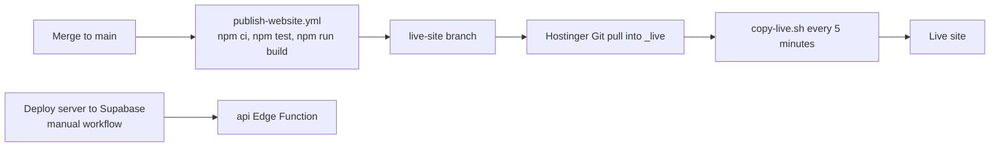

# Architecture

Learn With Why has three parts: a static React website, one Supabase Edge Function that holds every business rule, and a PostgreSQL database with private file storage. This page explains how they fit together and how the main flows work.

## Components

| Part | Where it runs | Source |
|---|---|---|
| Customer website, staff panels, viewer | Static files on Hostinger | [`frontend/`](../frontend) |
| API (`api` Edge Function, Deno, TypeScript) | Supabase, Mumbai region | [`supabase/functions/api`](../supabase/functions/api) |
| Database (PostgreSQL) | Supabase | [`supabase/migrations`](../supabase/migrations) |
| File storage (`worksheets` private, `covers` public) | Supabase Storage | [`20261007120700_storage.sql`](../supabase/migrations/20261007120700_storage.sql) |
| Sign-in | Supabase Auth plus the API's own session records | [`lib/auth.ts`](../supabase/functions/api/lib/auth.ts), [`routes/auth.ts`](../supabase/functions/api/routes/auth.ts) |
| Payments | Razorpay (Stripe and PayPal optional) | [`gateways/`](../supabase/functions/api/gateways) |
| Email | Brevo or Resend through an outbox; Supabase Auth for sign-up codes | [`lib/mail.ts`](../supabase/functions/api/lib/mail.ts) |
| Publishing | GitHub Actions and Hostinger Git deployment | [`.github/workflows`](../.github/workflows) |

## Website

- Two entry pages: [`index.html`](../frontend/index.html) (the site and the staff panels, routed with React Router) and [`viewer.html`](../frontend/viewer.html) (the protected viewer with pdf.js).
- [`services/api.js`](../frontend/src/services/api.js) is the single client for the API. It adds the publishable key and the bearer token to each call and turns error responses into readable messages.
- [`services/supabaseAuth.js`](../frontend/src/services/supabaseAuth.js) handles sign-up and email confirmation with Supabase Auth. The real sign-in goes through the API, which returns the session after the email code is checked.
- Values in [`src/data`](../frontend/src/data) (prices, plans, free sheets, print allowances) are fallbacks only. The server's answers to `GET /api/config` and `GET /api/worksheets` replace them at load time.
- The scroll background is 960 WebP frames decoded on demand ([`frameEngine.js`](../frontend/src/services/frameEngine.js)); the animals, birds and waterfalls are drawn on separate canvases ([`walkers.js`](../frontend/src/services/walkers.js), [`scenery.js`](../frontend/src/services/scenery.js)).
- After `vite build`, [`scripts/build-seo-pages.mjs`](../frontend/scripts/build-seo-pages.mjs) writes static topic pages and the sitemap from the live catalogue, falling back to a saved snapshot when the API cannot be reached.

## API

- [`index.ts`](../supabase/functions/api/index.ts) starts the function; [`lib/app.ts`](../supabase/functions/api/lib/app.ts) handles CORS (only `ALLOWED_ORIGINS`), parses the request, finds the route and maps errors to JSON.
- Each query runs in a transaction that switches to the least-privilege role `lww_api` ([`lib/db.ts`](../supabase/functions/api/lib/db.ts)).
- Settings that staff can change (access hours, prints, prices, tax, sign-in rules, sharing rules) live in the `settings` table and are read through [`lib/settings.ts`](../supabase/functions/api/lib/settings.ts), which also holds the defaults.
- Rate limits, analytics, notifications and security events are recorded through [`lib/guard.ts`](../supabase/functions/api/lib/guard.ts).

## Main flows

### Sign-up and sign-in

1. Sign-up: the website calls Supabase Auth with the customer's email and chosen password. Supabase emails a 6-digit code, and the account works only after the code is confirmed. A database trigger then marks the profile as verified.
2. Sign-in: the website posts the email and password to `POST /api/auth/login`. The API checks the password with Supabase Auth, the account state and the sharing agreement, then emails a 6-digit code. The new session is kept encrypted (AES-GCM, key from `LOGIN_OTP_ENCRYPTION_KEY`) and the code only as a hash in `login_otp_challenges`.
3. `POST /api/auth/verify-login-otp` checks the code, opens an `app_sessions` record and returns the session to the browser.
4. Every later request checks the token and the session record, so staff can end or block one session without affecting others.

### Purchase

1. `POST /api/quote` prices the cart on the server (country, tax, fees, coupons) and stores the quote for 15 minutes.
2. `POST /api/pay/order` creates a Razorpay order from the stored quote.
3. After Razorpay Checkout, `POST /api/pay/verify` (or the signed webhook `POST /api/pay/webhook`) checks the signature, order, amount and currency.
4. `private.fulfil_order` locks the order and grants access exactly once, however many times verification arrives. The same transaction queues the purchase email, notifications and the audit record.
5. The entitlement ends after the configured access hours (default 1); a class plan lasts its months.

### Opening a sheet

1. `POST /api/access/:id` checks the entitlement (or that the sheet is free) and returns a signed, short-lived view token. Visitors who are not signed in get a guest token for free sheets only.
2. The viewer calls `GET /api/view/meta`, `GET /api/view/file` and `GET /api/view/page`. Each call verifies the token and checks the database again: entitlement, session, account and any suspension.
3. The PDF is read from the private `worksheets` bucket and stamped on every page with the customer's email, order and date ([`services/watermark.ts`](../supabase/functions/api/services/watermark.ts)). The original file is never changed.
4. The viewer asks again every 60 seconds by default and closes the sheet when access has ended. Prints go through `POST /api/view/print`, which counts them against the allowance.

### Account sharing

1. The API records sessions, devices, networks and viewer use in `access_log`.
2. Enabled `security_rules` turn patterns into incidents. One new device or a changed IP address never opens an incident on its own.
3. Staff confirm an incident to make it a warning; the two-device rule confirms itself.
4. At three active warnings (configurable), paid access is paused. The customer can appeal; staff decide in the Security section.

## Deployment

- The website publishes itself after every merge that changes `frontend/`. The copy script only replaces changed files and never deletes.
- The API is deployed on demand with the **Deploy server to Supabase** workflow or `supabase/deploy-server.bat`.
- Database migrations are applied to the live project before the code that depends on them is merged.
